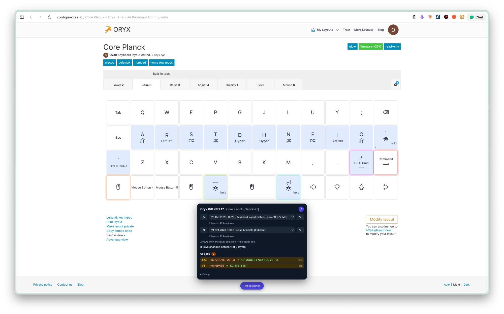
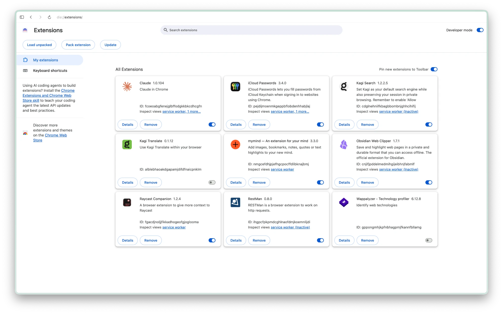
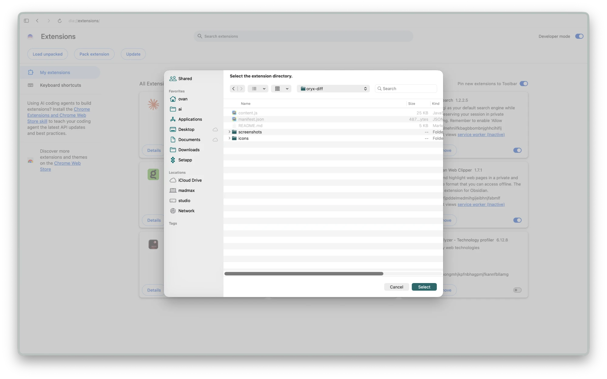
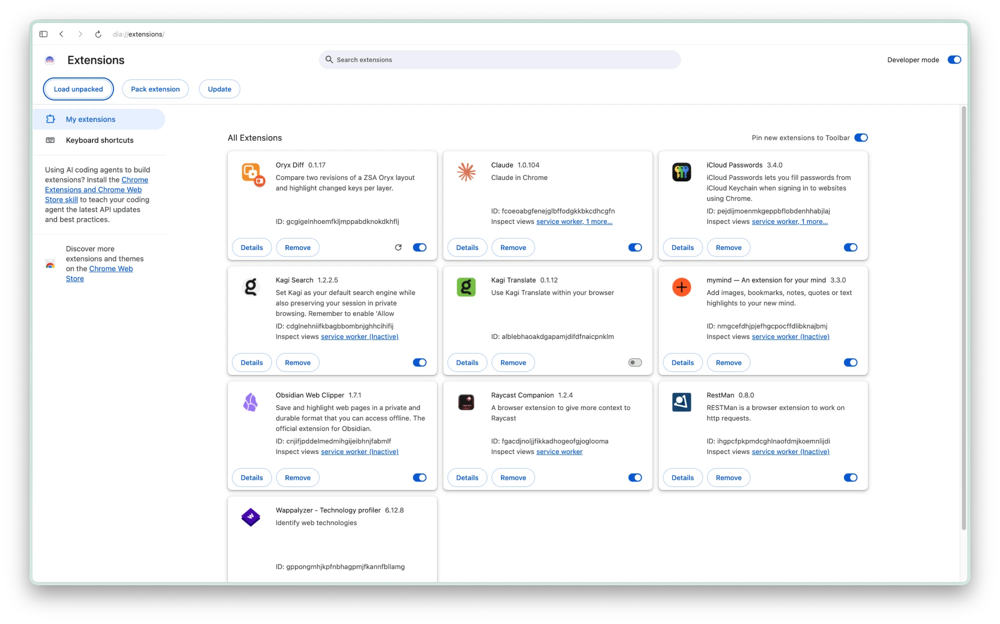
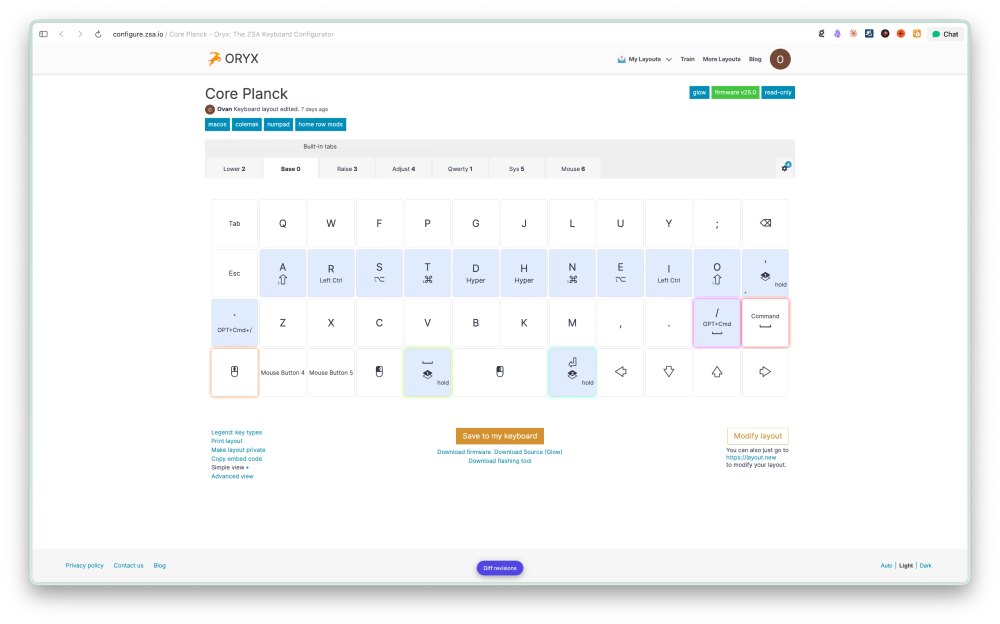
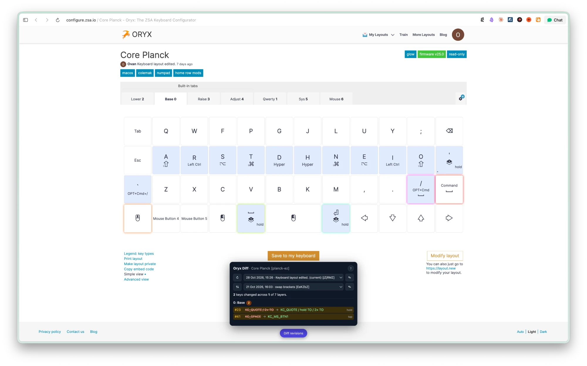
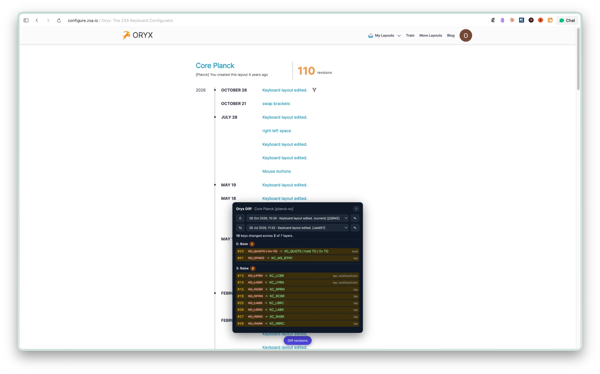

# Oryx Diff

A small Chrome extension for [Oryx](https://configure.zsa.io), the ZSA keyboard configurator. It compares two revisions of a layout and lists every key that changed, per layer.

Oryx keeps a full revision history but has no way to compare revisions. If you tweak a layout a lot ("swap thumbs", "and back", "Keyboard layout edited." ×20), this panel shows what actually changed between any two of them.



## Install

The extension isn't in the Chrome Web Store, so you load it from this folder as an "unpacked" extension. It works in Chrome and other Chromium-based browsers (Edge, Brave, Arc, Dia, …).

### 1. Get the files

Either clone the repo:

```bash
git clone https://github.com/ovanbiervliet/oryx-diff.git
```

or click **Code → Download ZIP** on the GitHub page and unzip it. Put the `oryx-diff` folder somewhere permanent: the browser reads the extension from that folder every time it starts, so don't move or delete it afterwards.

### 2. Turn on Developer mode

Open `chrome://extensions` (in other browsers it may be `edge://extensions`, `brave://extensions`, and so on) and switch on **Developer mode** at the top right. The **Load unpacked** button appears.



### 3. Load the extension

Click **Load unpacked** and select the `oryx-diff` folder, the one that contains `manifest.json`. Then click **Select**.



**Oryx Diff** now appears in your list of extensions and is switched on.



### 4. Open Oryx

Open or refresh a tab on [configure.zsa.io](https://configure.zsa.io) and sign in as usual. The extension only runs on that site.

### Updating

After pulling new changes (or editing any file in the folder), click the reload button (↻) on the extension's card in `chrome://extensions`, then refresh the Oryx tab.

## Usage

### 1. Open the panel

On any Oryx page, a **Diff revisions** button sits at the bottom center of the window. Click it to open or close the panel.



### 2. Pick two revisions

The panel title shows the layout's name and keyboard, for example `Core Planck [planck-ez]`. Below that are two dropdowns, each listing every revision with its date, title and revision ID:

- **Top dropdown:** the newer side of the comparison. It starts on the revision marked **(current)**.
- **Bottom dropdown:** the older side. It starts on the revision just before the current one.

**(current)** is the revision you have open. On a layout page that's the revision in the URL (`…/layouts/<layout>/<revision>/<layer>`). On pages without one, such as the history page or `…/latest/…`, it's the newest revision. So if you open an older revision and then the panel, it shows what that revision changed compared with the one before it.

The comparison runs as soon as you change either dropdown.



| Control | What it does |
|---|---|
| ↻ | Reload the revision list and clear cached revisions |
| ⇅ | Swap the two selections |
| ✎ | Open that revision in Oryx's layout view |
| ? | Show or hide details: the version number, extra info and the Debug section. This setting is remembered. |

With details hidden, the panel shows only the comparison, as above. With details shown, you also see the version, the number of layers and keys per layer of each revision, and the Debug section:


### 3. Read the result

The summary line gives the total, for example **8 keys changed across 1 of 5 layers**. Then, for each layer that changed:

- The layer number and name, plus how many keys changed on it (`3: Syms 8`).
- One row per changed key:
  - the key's position (`#13`)
  - the old action, struck through
  - the new action
  - a tag naming which part of the key changed: `tap`, `hold`, and so on

Arrows always read **bottom selection → top selection**.

A key's action is written the way QMK names it (`KC_LPRN` is the left parenthesis). Keys that do more than one thing combine their parts:

- `hold TO` means the key switches layers while held.
- `2× TO` means it does that on a double tap.
- `tap-hold` covers tap-hold behaviour.

For example, `KC_QUOTE / 2× TO` → `KC_QUOTE / hold TO / 2× TO` means a hold action was added to the quote key.

### It also works from the layout history page, on any ZSA keyboard

On **My layouts → (a layout)**, the page with the revision timeline, the panel works the same way. This is handy for layouts you aren't currently viewing. Here the current revision of a Planck EZ layout is compared with an older one, with changes on two layers:



## How it works

- The script runs inside the Oryx page. When Oryx loads a layout, the script reads the same data from Oryx's own requests, so you don't need to log in separately or set up an API key.
- If it needs a revision Oryx hasn't loaded yet, it requests that revision from Oryx's own server (`oryx.zsa.io`) with your existing session. Nothing is sent anywhere else.
- Each revision it fetches is kept in memory until you press ↻ or reload the page.
- Two keys count as changed only if their saved definitions differ: action, hold, double tap, label, colour or tapping term.

## Troubleshooting

- **"No revisions seen yet":** open the layout's history in Oryx once, then press ↻.
- **Something looks wrong:** turn on details with **?**, open **Debug**, and click **Copy debug**. The copied text shows which revisions were loaded and how. Include it when reporting a problem.

## Files

```
oryx-diff/
├── manifest.json   Chrome extension manifest (MV3)
├── content.js      The whole extension
├── icons/          icon.svg (source) + 16/32/48/128 px PNGs
├── screenshots/    Images used in this README
└── README.md
```

The version number appears in two places, `manifest.json` and the `VERSION` constant at the top of `content.js`. When you change it, change both.

Current version: **0.1.17**
